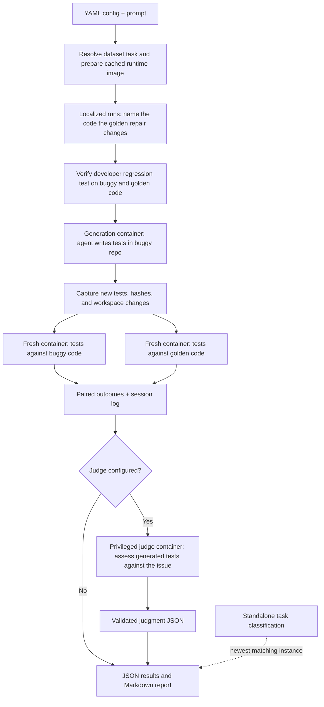

# Oracle Lab

## Quickstart

Requirements:

- Python 3.11 or later and [uv](https://docs.astral.sh/uv/).
- Docker with a running Linux daemon.
- A credential for the provider the configuration selects.
- A Unix host (Linux or macOS). The CLI uses Unix signals to enforce pull and
  build deadlines.

Copy the local secrets file and add your API keys:

```sh
# Create the local secrets file if you don't already have one.
[ -f .env ] || cp .env.example .env
```

Run from the repository root:

```sh
uv sync --extra dataset --extra dev

uv run oracle-lab run configs/smoke.yaml
```

## About

Oracle Lab measures how well coding agents write unit tests for code that
already contains a bug. The agent gets a buggy repository and a request to write
tests. It does not see the issue description or the fix. Oracle Lab then runs
the same tests against the buggy version and the fixed (golden) version. It
records the paired pass/fail outcomes.

A separate `classify` command labels SWE-bench and SWE-rebench V2 problems. The labels
cover defect mechanism, test setup, oracle availability, scope, and benchmark
quality. A run's report shows the newest classification for its instance, if
one exists.

80% of this repo is just coordinating containers and managing data in and out of them.

## Architecture / pipeline

The host starts Docker containers, captures the generated tests, and scores
them. The generation container holds the repository, its Python environment, and
the selected agent CLI. Evaluation uses fresh containers, so both versions run
the same captured tests.



## Usage

### CLI

```sh
# Generate tests and evaluate both code versions.
uv run oracle-lab run configs/smoke.yaml

# Check instances before a paid run: build the image, run the reference pair,
# and run one fixed test the way generated tests run. No model calls.
uv run oracle-lab preflight configs/smoke.yaml [more configs...]

# Rerun saved tests in fresh containers; no agent or model calls.
uv run oracle-lab evaluate runs/<run-id>

# Run the configured semantic judge after paired evaluation.
uv run oracle-lab judge runs/<run-id>

# Classify one problem independently of a benchmark run.
uv run oracle-lab classify configs/classification/example.yaml

# Rate the LLM judges' answers in a local web page. No Docker or model calls.
# See docs/human-review.md for sharing review sets with raters.
uv run oracle-lab review ../oracle-lab-data --rater <your-id>

# Agreement between raters, and how often they found the LLM judges right.
uv run oracle-lab agreement ../oracle-lab-data

# Browse saved agent traces as annotated timelines. Demo; needs `uv sync --extra trace`.
# See docs/features/trace-viewer/spec.md.
uv run oracle-lab trace runs

# Rebuild report.md from saved data. The session log is never regenerated.
uv run oracle-lab report runs/<run-id>

# Continue pending or failed jobs without repeating completed jobs.
uv run oracle-lab batch --resume batches/<batch-id>

uv run oracle-lab --help
```

### Configuration and credentials

Choose a sample configuration, or copy one and edit it.

The smoke configuration uses Claude Haiku through OpenRouter for generation and
judging. Set `OPENROUTER_API_KEY` in `.env` before running it.

The YAML interface defines:

| Section  | Controls                                                                     |
| -------- | ---------------------------------------------------------------------------- |
| `source` | Source adapter and instance ID                                               |
| `agent`  | Claude Code, Codex, or OpenCode harness; provider, model, one stopping limit |
| `judge`  | Optional semantic-judge rubric, harness, model, and stopping limit           |
| `task`   | Repository/localized scope, prompt, generated directory, and test visibility |
| `limits` | Setup/evaluation timeouts and container CPU/memory limits                    |
| `output` | Run-directory location                                                       |

See the [complete configuration reference](docs/configuration.md) for every
setting, default, validation rule, and harness-specific behavior.

### Results

| Artifact in `runs/<run-id>/` | Contents                                                  |
| ---------------------------- | --------------------------------------------------------- |
| `report.md`                  | Human-readable run summary and artifact links             |
| `status.json`                | The latest stage and its state, with any error            |
| `cost.json`                  | What the run's model stages spent on the OpenRouter key   |
| `inputs/`                    | Frozen prompt, resolved config, private instance, target  |
| `image-build/`               | Runtime image, build inputs, provenance, and logs         |
| `reference-check/`           | Private fail-on-buggy/pass-on-golden validation           |
| `generation/`                | Agent command, transcript, raw events, and workspace diff |
| `submission/`                | Captured generated tests, hashes, and violations          |
| `evaluation/`                | Paired result plus buggy and golden executions            |
| `judge/`                     | Judge workspace manifest, model evidence, and judgment    |
| `ground-truth/`              | Private issue text and golden repair, for readers         |

Standalone classifications are stored separately under
`classifications/<instance-id>/<attempt-id>/`; they are not copied into run directories.

See the [complete results and artifacts reference](docs/results.md) for the full
directory layout, JSON fields, logs, evaluation artifacts, and reevaluation
behavior. [Judging](docs/judging.md) covers the LLM judge.

For initial batch plots, run `uv sync --extra dataset --extra dev --extra analysis`
and open [notebooks/initial-results.ipynb](notebooks/initial-results.ipynb) with
the project's `.venv` kernel. Set `BATCH_DIR` in its first code cell to choose
which saved batch to inspect.

### Development

The package lives in `src/oracle_lab/`. It has one module or package per
pipeline stage, and `run.py` calls each stage once:

- `instance/` resolves a task.
- `container/images.py` prepares the runtime image.
- `localization/` names the code a localized run targets.
- `generation.py` runs the agent and freezes its submission.
- `evaluation/` runs that submission on both versions.
- `judge/` rates it.
- `report.py` renders the result.

The rest supports them. `cli.py` and `config.py` define the interface.
`container/` wraps the Docker Python SDK. `harnesses/` launches the agent CLIs.
`repository.py` prepares checkouts. [Container development](docs/containers.md)
covers the Docker API and building images on their own.

## Tests

```sh
# Local suite: no Docker or API keys required.
uv run pytest -q

# Formatting and lint checks.
uv run ruff check src tests
uv run ruff format --check src tests

# Docker integration checks after a smoke run has prepared its image.
ORACLE_LAB_SMOKE_RUN=runs/<run-id> uv run pytest -q -m docker
```

Local tests cover configuration, credentials, agent traces, artifacts, pytest
outcomes, and reports. Docker checks run handwritten tests on the
Requests task. They reach all four matrix cells and both test-visibility
settings. They do not call a model.

Docker may report a socket permission error after you join the `docker` group.
Run `newgrp docker`, or log out and back in. Then check `docker info` again.

## Misc notes

- The private regression check must pass before generation starts.
- The agent runs as a non-root user with only the selected credential. The host
  Docker socket and private run artifacts are not mounted.
- Generation, reference, and evaluation containers all have outbound network
  access, so repository tests run in the same environment each time.
- The agent gets a fresh Git repository with one commit: the prepared buggy
  snapshot. Internet use is not audited.
- Only new tests and fixtures under `oracle_tests/` are evaluated. Changes
  outside that directory are recorded as violations, and the results become
  diagnostic only. Configuration decides whether existing repository tests stay
  visible.
