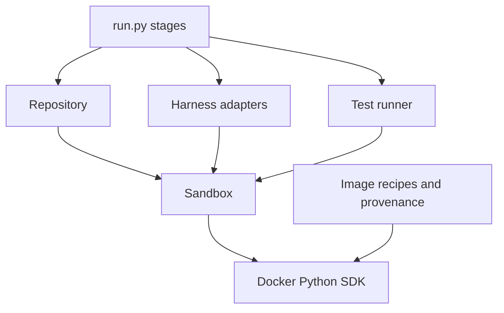

# Container development

Oracle Lab uses the official Docker SDK for Python. Images are built from the
checked-in [Dockerfiles](../src/oracle_lab/container/docker/README.md). The
host's container interface is a small wrapper around an SDK container. There is
no separate Docker engine layer or generic task framework.



## Building and starting

`container/images.py` builds images with the SDK:

- It copies a short allowlist of public files into separate harness and runtime
  build contexts. A run directory or repository root is never the build context.
- It resolves the parent images.
- The cache key covers the platform, parents, build arguments, and context hashes.
- Build inputs and raw event logs are kept after a failure.

Pull and build deadlines use `SIGALRM`, so the host CLI must run on a Unix main
thread. Docker's HTTP timeout is not enough on its own: it does not bound a
process or a streaming operation. Commands inside a container use their own
process supervisor instead. Interrupting setup stops the host's wait, but the
daemon may keep working. Check Docker after an interrupted build.

```python
with docker_client() as client:
    image = prepare_image(client, config, run_dir)
    with open_sandbox(client, image, config, Profile.EVALUATION, log) as sandbox:
        workspace = Repository(sandbox, config)
        workspace.prepare(base_commit, evaluation_dir)
```

Each container runs under a profile:

- Generation, evaluation, reference, and judge containers use Docker's outbound
  bridge network. Repository tests then see the same environment every time, and
  the judge can reach its model provider.
- Human-judge workspaces are named, long-running containers. They have no
  network and no model credential.

Every container gets resource limits and `no-new-privileges`, and no host
mounts. Creating and starting a container are separate steps, so a failed start
is still cleaned up. Context managers own the client and each container.

## Executing and transferring files

`sandbox.run(argv, ...)` takes the user, timeout, environment, stdin path,
stdout and stderr paths, and log options explicitly. Setup runs as root. The
shared harness launcher always runs as `oracle`.

A helper inside the container runs each command:

- It feeds the prompt file to the command's stdin.
- It supervises the command's whole process group.
- It records the exit code, elapsed time, and whether the command timed out.
  Exit code 137 alone does not mean a timeout.

A host watchdog stops the container if the helper or the transport stalls.

Output passes through credential redaction before it is saved. An SDK error from
a command that carries a credential is reported without its request contents.
Only the selected credential enters the command's environment. After the agent
exits, the container is stopped and restarted before capture. That ends any
detached processes the agent left behind.

File transfer:

- `upload(source, destination, contents=True)` copies a directory's children.
- `download(source, destination, contents=True)` exports a directory's contents.
  With the default `contents=False`, it expects one regular file.
- Archives from the container are checked before anything is written on the
  host. Links, special files, and paths that escape the destination are rejected.
- `required=False` allows a missing file. It does not hide a malformed archive or
  a transport failure.

Container-side logic lives in `container/helpers/`, so it is linted, packaged,
and unit-tested on local fixtures. The helpers are baked into the prepared image,
the judge's included. The judge runs in the run's own saved image, so it uses the
helper built with the image that produced the evidence.

Where each piece belongs:

- `repository.py` and its helper: workspace reset, rebuild, test visibility,
  baseline creation, and applying a repair.
- `generation.py`: sorting the submission's files and checking their integrity.
- `judge/workspace.py`: the privileged judge bundle. It is built there rather
  than by loosening either module above.
- Each harness adapter: its own flags, limits, and trace parsing.
  `harnesses/launch.py` holds the launch I/O they share.

## Verification

Local tests mock the SDK transport and run the helpers on local fixtures. They
need no daemon, network, or model credential.

The Docker-marked suite needs an existing smoke run and its runtime image. It
tests the real four-cell Requests pair and reevaluation. A separate opt-in smoke
check covers build, exec, and archive transfer on a local runtime. Neither calls
a model.
