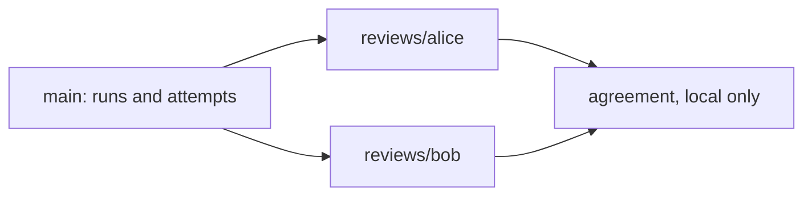

# Human review workflow

Human raters rate the answers the LLM judges gave: the generated-test judge's
judgment of each run, and the task classifier's classification of each task.
Every rater reviews every run and classification attempt in the review set.

This guide covers how a review set is shared and how reviews come back. What the
page shows and how reviews are saved is in [judging](judging.md#human-review).
What each rating means is in the page's "How to review" dialog.

## How it fits together

- The **maintainer** runs the pipeline and the LLM judges, as usual, in
  `oracle-lab`.
- The runs and classification attempts to review are copied into a separate,
  ordinary Git repository: the **data repository**, `oracle-lab-data`. It holds
  only data, no code.
- Each **rater** clones both repositories, runs the review page against the data
  repository, and pushes their reviews to their own branch.
- The maintainer merges the rater branches locally to compute agreement.



`main` holds only the review set. Reviews live only on the rater branches and on
the maintainer's local `agreement` branch. A rater who pulls `main` therefore
never receives another rater's reviews.

## For the maintainer

### Create the data repository

Create an empty private repository, for example `oracle-lab-data` on GitHub, and
give each rater write access. The runs contain the hidden repairs and reference
tests, so keep it private.

```sh
git clone <data-repository-url> oracle-lab-data
cd oracle-lab-data
mkdir runs classifications
```

### Add runs and classification attempts

Produce them as usual in `oracle-lab`:

```sh
uv run oracle-lab batch <batch>.yaml
uv run oracle-lab classify <classification-config>.yaml
```

Copy each run and attempt to review into the data repository, keeping the same
layout:

```sh
cp -r runs/<run-id> ../oracle-lab-data/runs/
mkdir -p ../oracle-lab-data/classifications/<instance-id>
cp -r classifications/<instance-id>/<attempt> ../oracle-lab-data/classifications/<instance-id>/
```

Only a completed judgment or classification can be reviewed. Check the set
before publishing it; the listing names anything that cannot be reviewed and
why:

```sh
uv run oracle-lab review ../oracle-lab-data --rater check --no-browser
```

Stop it with Ctrl+C, then commit and push `main`:

```sh
cd ../oracle-lab-data
git add runs classifications
git commit -m "Add review set"
git push origin main
```

To add more later, copy, commit, and push to `main` again, and tell raters to
pull it. Do not replace or rejudge a run that raters have started on: their
reviews rate the judgment that was there. Add the new judgment as a new run
instead.

GitHub refuses files over 100 MB. Runs are normally far smaller; the largest
file is usually `evaluation/results.json`.

### Collect reviews

Merge every rater branch into a local branch. Raters write to different
`reviews/<rater>/` directories, so the merge has no conflicts.

```sh
cd oracle-lab-data
git fetch origin
git switch -c agreement origin/main
git merge origin/reviews/<rater-1> origin/reviews/<rater-2>
```

Compute agreement from this branch, running the command from `oracle-lab`:

```sh
uv run oracle-lab agreement ../oracle-lab-data
```

It lists any target a rater has not reviewed yet. See
[agreement](judging.md#agreement) for what it reports.

Do not push the `agreement` branch, and never merge it or a rater branch into
`main`. To refresh it later, delete it and repeat these steps.

## For raters

### Set up once

You need Git, [uv](https://docs.astral.sh/uv/), network access to GitHub, and a
web browser. You do not need Docker or any API key.

Clone both repositories side by side:

```sh
git clone <oracle-lab-url> oracle-lab
git clone <data-repository-url> oracle-lab-data

cd oracle-lab
uv sync
```

Choose a rater ID: letters, digits, `-`, and `_`, such as `alice`. Use the same ID
every time. Create your branch in the data repository:

```sh
cd ../oracle-lab-data
git switch -c reviews/<your-id>
```

### Review

From `oracle-lab`:

```sh
uv run oracle-lab review ../oracle-lab-data --rater <your-id>
```

The page opens in your browser. It lists every target with your progress. Read
the "How to review" dialog the first time, then work through the list. Press
Ctrl+C in the terminal to stop the server.

The first time you open a target, the page fetches that repository at the
task's commit from GitHub. That takes a few seconds and is cached under
`~/.cache/oracle-lab/repos/`.

You can stop and resume at any time. Saved reviews are files in the data
repository. Ratings you have not saved yet stay in your browser.

### Hand in your reviews

Commit and push your branch whenever you want to save your progress remotely,
and when you finish:

```sh
cd oracle-lab-data
git add runs classifications
git commit -m "Reviews by <your-id>"
git push -u origin reviews/<your-id>
```

Only your own `reviews/<your-id>/` and `reviews-history/<your-id>/` directories
should appear in `git status`. Do not open other raters' branches.

### Get new targets

When the maintainer adds targets, merge `main` into your branch and restart the
page:

```sh
cd oracle-lab-data
git fetch origin
git merge origin/main
```

To get a newer version of the review page, run `git pull` and `uv sync` in
`oracle-lab`.

### Problems

| Problem | What to do |
|---|---|
| A target is listed under "Can't be reviewed" | Nothing. The listing gives the reason; tell the maintainer if it looks wrong. |
| A tab says a fetch failed | Check your network connection to GitHub, then reload the page. |
| `Address already in use` | Another program uses the port. Add `--port 8800`, or any free port. |
| The browser did not open | Open the URL the command printed. |
| Reviewing on a remote machine | Start it with `--port 8800 --no-browser`, forward that port with `ssh -L 8800:127.0.0.1:8800 <host>`, and open `http://127.0.0.1:8800/` locally. Use the same port number on both ends. |
